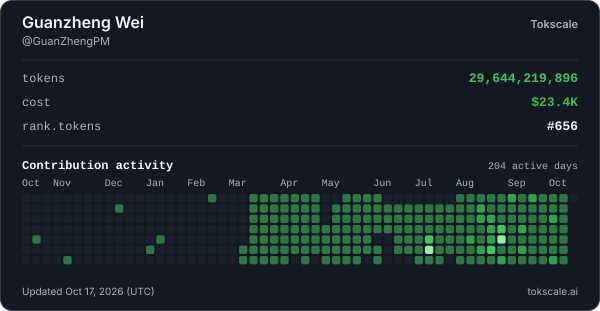

  
  
  
  
  

## 🛠 What I'm Building · 正在做的项目

<table>
<thead>
<tr><th align="left" width="220">Project / 项目</th><th align="left">Description / 核心机制与技术简介</th></tr>
</thead>
<tbody>
<tr><td colspan="2"><b>Coding Agent Harness</b></td></tr>
<tr>
  <td><a href="https://github.com/GuanZhengPM/AAA-Agent">AAA-Agent</a></td>
  <td><b>Terminal coding agent built from scratch.</b> Adapts execution lanes (direct / guided / orchestrated), reasoning efforts, and verification policies to task scope and model capability. Features host-level write-isolation for subagents and native multi-provider OAuth. <b>自适应终端 Coding Agent</b>：根据任务复杂度与模型能力动态调整执行路线、推理预算与验证策略；主 Agent 负责写入，子 Agent 只读隔离；原生集成多厂商 OAuth 登录。</td>
</tr>
<tr>
  <td><a href="https://github.com/GuanZhengPM/looongtime-agent">looongtime-agent</a></td>
  <td><b>Execution harness for long-horizon coding tasks.</b> Manages durable task states and cross-session resume. Builds a ProofGraph requiring host test verification rather than model self-reports to judge task completion. <b>长程编码任务 Harness</b>：支持任务状态持久化与中断恢复；构建 ProofGraph 证据链，以宿主环境下的真实测试脚本检验作为完成依据，替代模型自身的完成自述。</td>
</tr>
<tr>
  <td><a href="https://github.com/GuanZhengPM/agent-merge">agent-merge</a></td>
  <td><b>Multi-agent orchestration with Git-style version control.</b> Runs workers in isolated Git worktrees, selects patches via tests, and records trajectories as a content-addressed DAG for N-way merging and session bisecting. <b>多 Agent 会话版本控制与编排</b>：以类 Git 方式管理 Agent 探索轨迹，多个 Agent 在独立 Git worktree 中并行执行任务；通过测试筛选可用 Patch，支持结论合并与类似 <code>git bisect</code> 的步骤排查。</td>
</tr>
<tr>
  <td><a href="https://github.com/GuanZhengPM/agent-learning-gate">agent-learning-gate</a></td>
  <td><b>Governance gateway for agent memory and rules.</b> Checks evidence and scope before persisting rules (<code>CLAUDE.md</code>, <code>.cursorrules</code>) to avoid hardening one-off feedback into global rules; maintains a decision ledger of rejected approaches. <b>Agent 长期记忆与规则管控</b>：在写入规则或 Skill 前校验证据与作用域，避免把一次性反馈固化为长期指令；维护追加式决策账本，保留被否决的负向方案，防止新会话重复尝试。</td>
</tr>
<tr><td colspan="2"><b>Speech Processing · 语音处理</b></td></tr>
<tr>
  <td><a href="https://github.com/GuanZhengPM/TurnAlign">TurnAlign</a></td>
  <td><b>Streaming ASR and speaker diarization orchestration.</b> Stabilizes streaming text via LocalAgreement; decouples transcription, word-level timestamps, and speaker tracking before timeline fusion; supports pluggable backends and cross-hardware profiles. <b>流式 ASR 与说话人编排</b>：基于 LocalAgreement 算法稳定流式文本输出，抑制句尾跳动；解耦正文、词级时间戳与说话人轨道并在时间轴上融合；支持跨硬件 Profile 调度与识别模型热插拔。</td>
</tr>
<tr>
  <td><a href="https://github.com/GuanZhengPM/DayAudio">DayAudio</a></td>
  <td><b>Local-first transcription and summarization for long audio.</b> Uses deterministic chunking and resumable execution over SQLite/WAL for day-long recordings; supports primary speaker enrollment and generates summaries linked back to audio timestamps. <b>长音频离线转写与摘要系统</b>：针对全天长录音进行确定性切块与本地离线处理，基于 SQLite/WAL 实现中断续跑；支持主说话人声纹注册，生成的逐行摘要均保留源音频的时间戳锚点。</td>
</tr>
<tr><td colspan="2"><b>Tools · 工具</b></td></tr>
<tr>
  <td><a href="https://github.com/GuanZhengPM/paper-resume">纸页简历 · Paper Resume</a></td>
  <td><b>Local Markdown resume editor with exact one-page layout.</b> Features dual-pane browser editing and CLI/Skill interfaces for agent collaboration; automatically adapts margins and gaps into a single-page PDF. <b>本地 Markdown 简历编辑与单页排版</b>：支持浏览器端实时编辑与 Agent 命令行协同；通过确定性排版规则自适应调整间距收拢至单页，导出所见即所得的 PDF。</td>
</tr>
<tr><td colspan="2"><b>Blog · 博客</b></td></tr>
<tr>
  <td><a href="https://guanzhengpm.github.io/">个人博客</a></td>
  <td><b>Monthly engineering blog.</b> Monthly notes on recruiting, LLMs, agents, and product judgment. 关于招聘、模型、Agent、产品的月更博客。</td>
</tr>
</tbody>
</table>

## 🔥 Token Furnace · Token 使用记录

